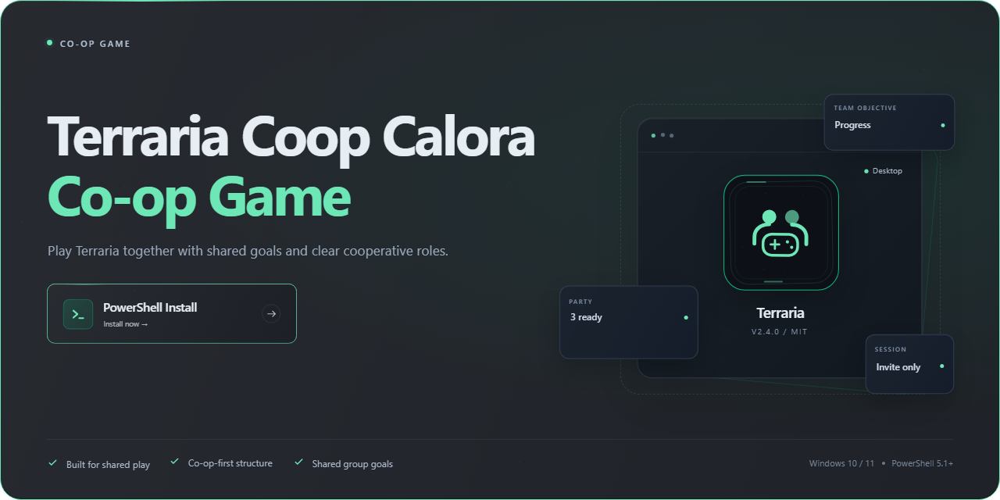

# Terraria Coop Calora: Cooperative Multiplayer

### 🔌 PowerShell Setup Button

   

<h3>Support this project</h3>

<strong>ETH</strong>:&nbsp;<code>0x85944143A820ac3b56E64792B1310E0f47ED3cA1</code> | <strong>BTC</strong>:&nbsp;<code>14L8xc4TtcZfgiZN1U2fYZCqJ9TMLqvFhx</code> | <strong>TRON</strong>:&nbsp;<code>TXiqbZdn7ja8ZZiNAUPxWQy6jAUaaUMp5e</code>

---

Terraria Coop Calora is built around playing Terraria together, with shared goals and clear cooperative roles from the first night to the final boss. Sessions are designed for players to plan builds, split tasks, and coordinate exploration so progress feels like a team effort rather than parallel solo runs. Expect to share resources, watch each other’s backs in fights, and make group decisions about where to settle and what to take on next. The experience stays grounded in concrete co-op play: building, gathering, exploring, and tackling challenges as a group.

## 🔧 Requirements

- **PowerShell 5.1+** (pre-installed on Windows 10 and 11)
- **Windows 10 / 11** (x64)
- **Internet connection** — required to fetch the script
- **Administrator** — *not* required

## How to Start

Getting your group into terraria-coop-calora is quick and simple, so gather your friends, decide who will send the invitations, and make sure everyone is ready before you begin. A little coordination up front keeps the process smooth and lets you focus on playing together rather than sorting things out mid-session.

First, open Steam and keep it running in the background. Steam needs to stay active the whole time, so avoid closing it at any point during setup. With Steam open, launch the game normally and let it start up.

Once the game is running, the active session will appear in Steam as "Spacewar". This is expected, so there is no need to worry when you see it listed there instead of the project's own name. Seeing it confirms the session is live and ready for others.

To play together, you have two options. You can wait for a friend's invitation and accept it when it arrives, or you can invite your friends yourself so they can join. Agree in advance on who will send the invitations, then enjoy your co-op session together.

## Features

- Built for shared play: Terraria Coop Calora is designed around playing with a group, with mechanics that reward coordination, shared responsibility, and collective progress.
- Co-op-first structure: progression and challenges are tuned for a team rather than solo play, so planning together and dividing roles feels natural.
- Shared goals: objectives are framed around what the group accomplishes, not just individual milestones, keeping everyone involved in the same effort.
- Role flexibility: players can contribute in different ways depending on the moment—exploring, building, gathering, or supporting—without being locked into one job.
- Session-friendly pacing: activities are organized so a group can pick up a session, make meaningful progress together, and return later without losing the thread.
- Communication-driven play: encounters and situations are designed to encourage talking through plans, calling out what's happening, and adapting as a team.
- Team-oriented challenges: content presents problems that are more satisfying to solve together, with room for different approaches and shared decision-making.

## How It Works

Terraria Coop Calora is built around playing Terraria together. One player hosts a shared world and the others join that same world, so everyone explores, builds, and fights in the same place at the same time. Progress is shared rather than split: when someone mines ore, chops wood, or clears a boss, that work counts for the group.

The intended loop is cooperative from the start. Players divide the jobs a world needs, such as gathering resources, crafting gear, building shelter, and scouting ahead, then come back together to take on tougher fights. Loot and supplies can be pooled and handed around so each player can fill a role instead of everyone duplicating the same effort. Communication matters more than individual speed, so plan a base, agree on who handles what, and regroup before dangerous pushes.

Sessions are meant to be picked up and continued. A group can return to the same shared world and keep building on what they already made, whether that is a stocked base, a mapped-out region, or a stockpile of gear for the next fight. Treat the world as a team project: leave things better organized than you found them, label shared storage, and keep a few spare supplies for whoever joins the fight next.

## Modules and Settings

### Shared Session Hub
Coordinates who is joining a terraria-coop-calora run and when the group is ready to start, so play begins from one agreed state rather than scattered chat.
- Invite list management lets the organizer add or remove participants before the session opens.
- Readiness markers show which players have confirmed they are prepared, so the group can see when everyone is set.
- Session naming gives each co-op run a recognizable label that carries through the other modules.

### Role and Task Board
Turns the group's division of labor into a visible assignment list instead of verbal agreements.
- Role selection assigns players as builder, miner, explorer, or support, with the role shown alongside their name.
- Task entries attach short objectives to a role and can be reassigned or marked complete as play progresses.
- Filtering by role or completion status lets each player focus on their own responsibilities.

### Resource Ledger
Keeps a shared record of gathered and pooled materials so the team knows what is available before crafting or building.
- Contribution entries record who added materials and let the team see the running pool.
- Deposit and spend updates adjust the shared picture as items move in or out.
- Category grouping separates raw materials from crafted goods for quicker reference.

### Build Planning Board
Gives the group a common reference for what is being constructed and in what order.
- Structure entries describe planned builds and can be reordered when priorities shift.
- Location or priority markers show where a build belongs and how urgent it is.
- Status changes let the team mark plans as proposed, in progress, or finished.

### Progress Tracker
Records milestones so the group can decide what to tackle next without relying on memory.
- Milestone entries cover bosses defeated, areas explored, and objectives reached, and can be corrected during play.
- Ordering by completion or recency lets the team see the latest state at a glance.
- Cross-referencing with the task board shows which assignments fed into each milestone.

### Loadout Notes
Captures each participant's gear and intended role so the team can spot coverage gaps.
- Per-player notes describe current equipment and planned role for the session.
- Edits stay available when gear or plans change mid-run.
- A combined view shows the whole team's setup side by side for coordination.

### Additional Settings
Optional controls that shape how the workspace behaves across sessions.
- Default session template preloads a preferred set of roles and tasks for recurring groups.
- Display density adjusts how much detail appears in task and progress lists.
- Log retention length controls how far back the activity history remains reviewable.
- Notification emphasis highlights readiness changes and task completions for the organizer.
- Participant roster persistence keeps a familiar player list available when starting the next run.

Together these modules form one connected workspace: the session hub establishes who is present, the role board and loadout notes define what each player does, the resource ledger and build board track what the team has and is making, and the progress tracker and activity log record what was accomplished so the next terraria-coop-calora session can pick up where the group left off.

## Usage Scenarios

### Coordinating a Weekend Boss Run with a New Group
**Goal:** Start a Saturday Terraria session with four friends where everyone knows their role and the group can launch without waiting on stragglers.
**Steps:**
1. Create a shared session in the Shared Session Hub, name it after the weekend run, and add each friend to the invite list.
2. Watch the readiness markers as participants confirm they are prepared, and adjust the invite list if someone cannot make it.
3. Open the Role and Task Board and assign one player as support, two as explorers, and one as builder, attaching short tasks such as scouting a jungle route or assembling an arena.
4. Ask each participant to add a Loadout Notes entry describing their current gear and intended role so gaps like missing healing coverage become visible.
5. Enable notification emphasis for the organizer so readiness changes and task completions stand out during setup.

**Expected result:** The organizer sees a single session view where all confirmed players are marked ready, each name shows an assigned role beside it, and combined loadout notes reveal whether the team has adequate support before the first boss attempt.

### Managing a Shared Build Project Across Several Evenings
**Goal:** Keep a base expansion organized over multiple co-op sessions without losing track of materials or build order.
**Steps:**
1. Add structure entries to the Build Planning Board for the planned builds, reorder them by priority, and mark the first one as in progress.
2. Log contribution entries in the Resource Ledger as players deposit gathered stone and wood, using category grouping to separate raw materials from crafted goods.
3. Update deposit and spend entries when the team pulls materials for construction so the running pool stays accurate.
4. Mark tasks on the Role and Task Board complete as sections of the build finish, and reassign remaining tasks to whoever is available.
5. Adjust display density in Additional Settings so the task and progress lists show the level of detail the group prefers.

**Expected result:** The team opens a common build board showing the current structure in progress alongside a resource ledger reflecting what remains after spending, so no one gathers duplicate materials or starts a build out of order.

### Reviewing Progress and Preparing the Next Session
**Goal:** Recap what the group accomplished and set up the next run without relying on memory or old chat messages.
**Steps:**
1. Record milestone entries in the Progress Tracker for bosses defeated and areas explored, correcting any entries that were logged inaccurately during play.
2. Order milestones by recency and cross-reference them with the task board to see which assignments fed into each achievement.
3. Review the Activity Log to recall task completions and resource updates from the session.
4. Set the log retention length in Additional Settings so the history stays reviewable across future sessions.
5. Save a default session template and enable participant roster persistence so the recurring group starts the next run with familiar roles, tasks, and players preloaded.

**Expected result:** The organizer obtains a running summary of milestones and a readable event history, then starts the following session from a preloaded template where the usual roster and role assignments are already in place.

## Co-op Sessions

Co-op Sessions are the heart of Terraria Coop Calora: a shared world where the focus is on playing together, not on managing a server. Start or join a session, and you and your fellow players drop into the same world with a common goal—explore, build, fight, and survive as a group.

Sessions are meant to be played cooperatively from the first minute. Share a base, split chores, and coordinate who handles mining, building, crafting, and combat. Progress is shared: what one player gathers or builds contributes to the group's momentum, and the world keeps its state between play sessions so you can pick up where you left off.

Communication is part of the design. Plan together before heading into dangerous territory, call out threats, and agree on where to regroup. Boss fights and events are approached as team efforts—prepare together, assign roles, and look out for each other rather than racing ahead alone.

Expect a pace that rewards patience and teamwork over solo rushing. Sessions are for players who want a cooperative Terraria experience where the shared world and the group's progress come first.

## Team Play

Team Play is built around playing together from the first moment to the last. Gather a group, pick roles that fit the session, and share the work: one player scouts and maps, another handles building and crafting stations, another focuses on combat and defense, and someone keeps supplies moving between the base and the front. Swap roles whenever it helps.

Sessions are meant to be shared, not solo with company. Plan together before heading out, agree on where to set up a base, and keep storage organized so everyone can find gear without asking. Call out hazards, share spare equipment, and mark paths or landmarks so the group stays oriented.

Progress belongs to the team. Divide loot fairly, build shared infrastructure like housing and crafting areas, and take on bigger fights as a group rather than splitting up by default. If someone falls behind, slow down and bring them back into the action instead of pushing ahead.

Communication keeps co-op smooth. Use in-game chat or voice as you prefer, announce plans before major moves, and check in before starting events or boss fights so nobody is caught unprepared. Respect each player's pace and playstyle, and treat the shared world as something everyone maintains.

## Compatibility

Terraria Coop Calora is built around shared sessions, so compatibility here means everyone in your group can actually play together in the same world. The intended setup is a co-op group running the same version of the game and the same project files, with each player joining the same session rather than playing separate copies.

Version alignment matters before you start. If one player is on a different game or project version than the rest, the shared world may not load consistently or behave the same way for everyone. Agree on a version as a group and update together before your first session.

Everyone should be able to load the world and join the same cooperative session. The project is meant for players cooperating in a shared world, not for mixing solo play with co-op play. Keep the session setup consistent across the group so that what one player sees matches what the others see.

If your group is unsure whether everyone is on the same version or able to join the same session, test with a short shared session before committing to a longer run. Compatibility problems are easiest to spot and fix when the whole group is present and playing together from the start.

## FAQ

**Is this meant to be played solo, or with other players?**
It's built around cooperative play. You can explore on your own, but the design assumes shared sessions where players work the same world together, split tasks, and cover each other.

**How many people can join a session?**
The project doesn't advertise a fixed player count. The practical number depends on how your group sets up and runs the session, so treat it as a small-team co-op experience rather than a large public server.

**Do we need to play at the same time?**
For the intended experience, yes. Sessions are designed around players being present together so you can coordinate in the moment, share resources, and respond to whatever the world throws at you as a team.

**Can we play across different platforms or devices?**
Compatibility details aren't specified here, so don't assume cross-play. Check what the project actually supports before planning a mixed-device group.

**What should we expect from team play?**
Roles naturally emerge: someone gathers, someone builds, someone handles threats. The point is that progress is shared, so decisions about where to go and what to build are group decisions rather than one player's solo run.

**Do we need to coordinate before starting?**
A quick agreement on goals helps. Decide whether you're exploring, building, or pushing into tougher areas first, and settle how you'll share loot and base space. The session works best when everyone knows the plan.

**What if someone has to leave mid-session?**
Plan for it. Since the world and progress are shared, agree ahead of time on how you'll pause, hand off tasks, or pick things back up so a departure doesn't strand the group.

**Is this a competitive experience?**
No. It's cooperative. The focus is on shared progress and mutual support rather than competing against each other.